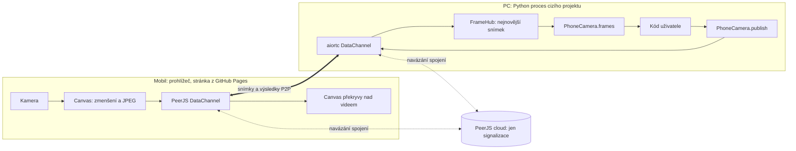

# Specifikace projektu: CAM-VISION-BRIDGE

## 1. Cíl

Python knihovna a webová stránka, které z mobilního telefonu udělají kameru a displej pro
computer-vision experimenty běžící na PC. Cizí Python projekt (např. ukázka s
[qrdet](https://github.com/Eric-Canas/qrdet)) dostává snímky z mobilu přes jednoduché API
a vrací strukturované výsledky, které mobil vykreslí přes živé video. Snímání ani zobrazování
už pak cizí projekt neřeší.

## 2. Scope

- **Python knihovna `cam_vision_bridge`** (instalovatelná přes `pip`):
  - veřejné synchronní API `PhoneCamera`: `frames()`, `publish(frame, items)`, `run(callback)`;
  - protokol zpráv a typů výsledků jako Pydantic modely (jediný zdroj pravdy kontraktu);
  - jádro `FrameHub` (asyncio): drží jen nejnovější snímek, řídí tok;
  - transport `PeerJsWebRtcTransport` (aiortc + minimální klient PeerJS signalizace) za
    rozhraním `Transport`; `FakeTransport` v paměti pro testy;
  - `start()` vrátí párovací URL; `show_pairing_qr` vypíše ji a ASCII QR. Smyčkový host nahradí IPv4 adresou tohoto počítače v LAN (DECISIONS #15).
- **Webová stránka pro mobil** (`web/`, Vue 3 + Vite + TypeScript), hostovaná na GitHub
  Pages pod cestou s hlavní verzí protokolu (`/cam-vision-bridge/v1/`):
  - kamera (přední/zadní), zmenšení snímku, JPEG, odeslání přes DataChannel;
  - vykreslení všech typů výsledků přes živé video, panel textů a metrik;
  - nastavení (kamera, rozlišení, FPS, kvalita JPEG), ukazatel FPS a latence;
  - Screen Wake Lock, fullscreen, srozumitelné stavy spojení a chyby.
- **Typy výsledků v1:** `box`, `quad`, `polygon`, `keypoints` (s volitelnými hranami),
  `polyline`, `text` (na pozici nebo do panelu), `metrics`.
- **Ukázka** `examples/qrdet_demo/` s vlastními závislostmi: detekce QR kódů přes qrdet,
  dekódování obsahu přes QReader.
- Nasazení frontendu na GitHub Pages přes GitHub Actions.
- Dokumentace v angličtině (`README.md`, docstringy), APM dokumenty česky.

## 3. Non-Goals

- Zpracování obrazu v mobilu (to dělal Astriot, tady ne).
- Nativní mobilní aplikace.
- WebSocket transport v MVP (jde přidat později za rozhraním `Transport`).
- WebRTC video track (VP8/H.264); snímky jdou jako JPEG přes DataChannel (DECISIONS #3).
- Vlastní PeerJS signalizační server ani TURN server (adresa signalizace a STUN/TURN je jen
  konfigurovatelná).
- Více mobilů současně připojených k jedné instanci `PhoneCamera`.
- Masky, obrázky nebo video posílané z PC zpět do mobilu.
- Nahrávání snímků a zdroj z video souboru / webkamery (kandidáti na pozdější epic).
- Režim „zmrazeného“ zpracovaného snímku (MVP kreslí přes živé video).
- Asynchronní veřejné API (DECISIONS #1 — pozdější rozšíření).
- Autentizace nad rámec náhodného, neuhádnutelného peer ID předaného QR kódem.

## 4. Klíčová technická rozhodnutí

Závazná rozhodnutí jsou v [`DECISIONS.md`](DECISIONS.md); zde jejich technický důsledek.

### 4.1 Architektura a tok dat

- **Spárování:** `PhoneCamera` vygeneruje náhodné PeerJS ID. `show_pairing_qr` vypíše QR
  s celou URL včetně `#peer=<id>`. Výchozí stránka knihovny je
  `https://ivomarvan.github.io/cam-vision-bridge/v1/`. Když je v URL smyčkový host,
  QR použije IPv4 adresu tohoto počítače, aby šel naskenovat z jiného zařízení
  (DECISIONS #15). Spojení zahajuje mobil, Python odpovídá. Peer ID je v hash části
  URL, takže se neposílá na server, který stránku jen doručí.
- **Na PC neběží žádný HTTP server.** Knihovna je čistý klient: PeerJS signalizace přes
  WebSocket klienta, data přes WebRTC. (Původní předpoklad FastAPI z briefu tím odpadá.)
- PeerJS spojení používá `serialization: "raw"`, aby PeerJS nepřidával vlastní kódování
  (binarypack) a Python s ním nemusel umět pracovat.

### 4.2 Protokol (verze 1)

- Zdroj pravdy: Pydantic v2 modely v `cam_vision_bridge.protocol`. Z nich se generuje
  JSON Schema (`schema/`, commitované) a z něj TypeScript typy pro `web/`.
- Každá zpráva nese verzi protokolu `v`; nesoulad hlavní verze = srozumitelná chyba na mobilu.
- **Mobil → PC:** `hello` (verze, zařízení, kamera, rozlišení); `frame` jako binární zpráva
  = délka hlavičky + JSON hlavička (`frame_id`, `captured_at`, `w`, `h`, `part`, `parts`)
  + JPEG data. Snímek větší než ~60 KB se dělí na části (limit zprávy v aiortc ~64 KB).
- **PC → mobil:** `welcome` (verze, volitelně požadované rozlišení/FPS); `result`
  (`frame_id`, `items[]`, `processing_ms`); `error`.
- **Souřadnice** ve všech výsledcích jsou normalizované na 0..1 vůči odeslanému snímku.
  Přepočet na zobrazení (zrcadlení přední kamery, ořez/letterbox videa) dělá mobil v jednom
  testovaném modulu.
- **Řízení toku:** mobil má nejvýš N (výchozí 1–2) snímků „na cestě“ bez výsledku;
  Python zpracovává jen nejnovější snímek, starší zahazuje. FPS se tak samo přizpůsobí
  rychlosti zpracování a latence neroste.

### 4.3 Python knihovna

| Vrstva | Odpovědnost |
|---|---|
| `protocol/` | Modely zpráv a typů výsledků; kódování/dekódování binárního snímku a jeho částí |
| `core/` | `Frame` (neměnný: `image` RGB `ndarray`, `frame_id`, `captured_at`, `width`, `height`, metadata kamery); `FrameHub` (asyncio, nejnovější snímek, řízení toku) |
| `transport/` | `Transport` (Protocol); `PeerJsWebRtcTransport`; `FakeTransport` pro testy |
| `api/` | `PhoneCamera` — synchronní fasáda: event loop ve vlákně na pozadí, thread-safe předávání; `run(callback)` |

- Jádro je asyncio; synchronní API je fasáda nad ním (DECISIONS #1).
- Dekódování JPEG přes OpenCV (`cv2.imdecode`); výstupní obraz RGB `uint8`.
- Python ≥ 3.11 (`requires-python` v `pyproject.toml` je autoritativní); Ruff, mypy
  `--strict`, pytest s markery `unit` / `integration` / `slow`.
- Konfigurace (adresa signalizace, STUN servery, cílové FPS/rozlišení, timeouty) přes
  parametry `PhoneCamera` s rozumnými výchozími hodnotami — žádné natvrdo zapsané adresy
  mimo výchozí konstanty.
- **Struktura repozitáře a importy:** knihovna v `src/cam_vision_bridge/` (src-layout,
  instalace `pip install -e .`), importy podle názvu balíčku
  (`from cam_vision_bridge.core import Frame`). To je vědomá odchylka od konvence
  `from src.… import` a `git_root_to_syspath` v `100-python.mdc`: knihovnu importuje cizí
  projekt, takže musí být importovatelná pod vlastním jménem. Odchylka bude zapsána
  v `DESIGN_RULES.user.md`.

### 4.4 Frontend

- Vue 3 (Composition API, `<script setup>`), Vite, TypeScript strict, Tailwind CSS, Pinia
  pro stav spojení a nastavení; Vue Router není potřeba (jedna obrazovka, parametry
  v hash URL).
- Knihovna PeerJS (pinned verze), vykreslování překryvů přes Canvas 2D.
- Vitest pro přepočet souřadnic, kodek snímků a reducer stavu spojení.

### 4.5 Bezpečnost

- Snímky a hlavičky z mobilu jsou **nedůvěryhodný vstup** (`080-agent-security.mdc`,
  `000-model-policy.mdc` → pásmo `high` pro tasky, které je zpracovávají): validace hlavičky
  Pydantic modelem, limity velikosti hlavičky, počtu částí a celkové velikosti snímku před
  dekódováním JPEG.
- PeerJS cloud vidí jen peer ID a SDP (včetně IP adres kandidátů), nikdy snímky ani
  výsledky — ty jdou šifrovaně (DTLS) peer-to-peer.
- `PhoneCamera` přijme jen jedno spojení najednou; další spojení odmítne.

### 4.6 Ošetření chyb

- Signalizační server nedostupný → výjimka s jasnou zprávou při startu `PhoneCamera`;
  na mobilu stav „signalizace nedostupná“.
- Mobil se odpojí → `frames()` čeká na nové připojení (volitelný timeout →
  specifická výjimka).
- Neplatná zpráva z mobilu → zalogovat (structured), zahodit, spojení nechat běžet.
- Výjimky v kódu uživatele bridge nespolkne — propadnou do jeho smyčky.

### 4.7 Docker

Rozhodnuto (DECISIONS #4): Python knihovna běží nativně ve venv — výjimka z Docker
politiky zapsaná v `DESIGN_RULES.user.md` (WebRTC/UDP/ICE v Docker bridge síti nefunguje
bez `network_mode: host`; knihovna běží v procesu cizího projektu). Node toolchain
frontendu (`web/`: build, testy, lint) běží v Dockeru s pinned image, `README.docker.md`
vznikne s ním v E030.

## 5. Předpoklady

- Repozitář `ivomarvan/cam-vision-bridge` na GitHubu je veřejný (nebo je k dispozici GitHub
  Pro), takže GitHub Pages lze použít.
- PC i mobil mají přístup k internetu (signalizace přes PeerJS cloud, STUN).
- Mobil a PC jsou typicky ve stejné LAN; spojení přes host/mDNS nebo STUN kandidáty stačí,
  TURN není potřeba. **Ověří spike E010** — včetně překladu mDNS kandidátů (`*.local`)
  v `aioice`.
- Primární cíl je Chrome na Androidu; Safari na iOS je „best effort“.
- Veřejný PeerJS cloud (`0.peerjs.com`) je dostatečně dostupný pro vývojový nástroj.
- 640×480 JPEG při 10–15 FPS (~0,5–1 MB/s) zvládne aiortc DataChannel v čistém Pythonu.
  **Ověří spike E010.**

## 6. Definition of Done projektu

- [ ] `pip install -e .` a příklad o max. ~10 řádcích (`PhoneCamera` + `frames()` +
      `publish()`) funguje end-to-end s telefonem: QR kód v terminálu → naskenovat →
      překryvy na mobilu.
- [ ] Ukázka `examples/qrdet_demo/` na mobilu zobrazuje quady nalezených QR kódů
      a dekódovaný text.
- [ ] S triviálním procesorem (bez CV) při 640×480 na LAN: ≥ 10 FPS a medián latence
      (odeslání snímku → vykreslení výsledku) ≤ 200 ms. Cílové hodnoty může upřesnit spike
      E010.
- [ ] Všechny typy výsledků v1 z § 2 se na mobilu vykreslují správně i s přední
      (zrcadlenou) kamerou.
- [ ] Frontend je nasazen na GitHub Pages pod `/v1/` automaticky z CI.
- [ ] Deterministická brána prochází: Ruff, mypy `--strict`, pytest (Python); vue-tsc,
      ESLint, Vitest (frontend).
- [ ] JSON Schema protokolu je vygenerované, commitované a TS typy frontendu z něj
      odvozené.
- [ ] `README.md` (anglicky) popisuje instalaci, spárování mobilu, API adaptéru, typy
      výsledků a omezení (internet, PeerJS cloud).

## 7. Source of Truth

1. [`DECISIONS.md`](DECISIONS.md) — rychlý registr rozhodnutí (kontroluje se jako první).
2. `spec.md` (tento dokument).
3. [`roadmap.md`](roadmap.md).
4. [`brief.md`](brief.md) — původní záměr (jen pro kontext; kde se liší, platí body 1–3).
